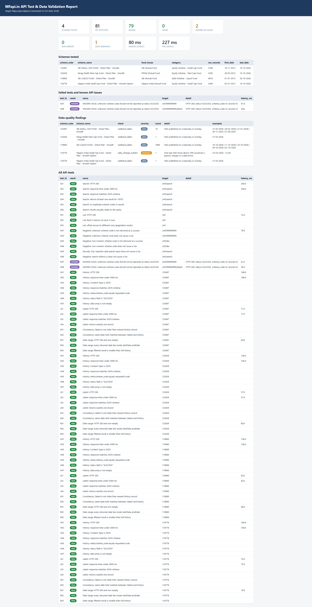
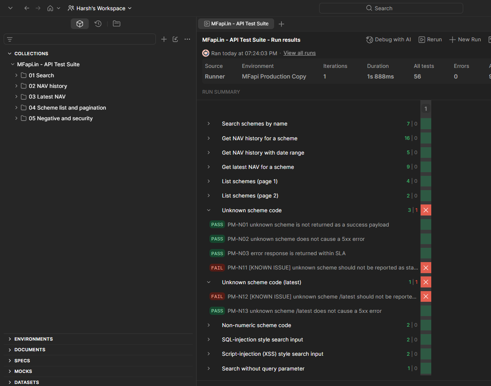

# Mutual Fund NAV API: Test & Data-Validation Framework

An automated QA framework for the public [MFapi.in](https://www.mfapi.in) mutual fund API. It combines **Postman/Newman** API tests with a **Python** data-validation engine that checks whether the NAV (Net Asset Value) time series coming out of the API can be trusted for portfolio valuation, returns and reporting.

**The question:** *If a broker app consumed this API, what could go wrong, and would we catch it before a customer saw a wrong number?*




## Highlights
- **56 Postman assertions** in 5 folders: contract, data integrity, cross-endpoint consistency, pagination, negative and security tests.
- **14 reusable data-quality checks** (bad formats, non-positive NAV, duplicate dates, future dates, gaps, frozen NAV, stale feed, ...) with an ERROR / WARNING / INFO severity model. Large one-day moves are **classified automatically**: a single bad record (spike that reverts) and a permanent break in the series (e.g. a 100x level shift) are ERRORs, while genuine market events stay as WARNINGs for human review.
- **Cross-endpoint consistency test:** `/latest` must agree with the newest record of the NAV history.
- **JSON-schema contract tests** that fail if the API changes a field name or type.
- **Negative and security tests** (unknown IDs, SQL-injection and XSS style input, information leakage).
- **Three real defects found in live data** (see Findings), including an API that reports unknown funds as successful.
- **A real API defect found and documented:** unknown scheme codes return HTTP 200 with `status: "SUCCESS"` (see Findings). It is tracked as a *known issue* that is reported on every run without failing CI.
- **20 offline unit tests** proving each check catches the defect it was written for, including regression tests built from real defects found in live data.
- **HTML, CSV and Excel reports** with pass/fail, response-time percentiles and examples of every data issue.
- **CI-ready:** exit code `1` on failures, GitHub Actions workflow included.

## How it works
```
              +--------------------+        +----------------------------+
 MFapi.in --->| Postman / Newman   |------->| newman_report.html         |
   (REST)     | 56 assertions      |        +----------------------------+
              +--------------------+
              +--------------------+        +----------------------------+
              | run_validation.py  |------->| validation_report.html/xlsx|
              |  - contract tests  |        | contract_results.csv       |
              |  - 14 DQ checks    |        | data_quality_issues.csv    |
              +--------------------+        +----------------------------+
                        ^
              pytest (unit tests, offline) and pytest -m live
```

## What is tested
| Area | Examples |
|---|---|
| Contract | status codes, JSON content type, JSON schema, `meta.scheme_code` equals the requested code |
| Data integrity | valid `dd-mm-yyyy` dates, no future dates, NAV numeric and above zero, no duplicate dates |
| Consistency | `/latest` vs history, date-range filter returns only dates inside the range |
| Behaviour | `limit` / `offset` pagination, search relevance, no duplicate search results |
| Robustness | unknown scheme code, non-numeric code, missing parameters, injection-style input |
| Performance | each response under the configured SLA, median and p95 latency in the report |

Full catalogue and reasoning: [`docs/TEST_STRATEGY.md`](docs/TEST_STRATEGY.md).

## Data-quality checks
| Check | Severity | Catches |
|---|---|---|
| `empty_dataset` | ERROR | no records returned |
| `unparseable_dates` | ERROR | dates that are not valid `dd-mm-yyyy` calendar dates |
| `non_numeric_nav` | ERROR | `N.A.`, blanks, text in the NAV field |
| `non_positive_nav` | ERROR | NAV of zero or below |
| `duplicate_dates` | ERROR | the same date repeated |
| `future_dates` | ERROR | NAV dated after today |
| `sort_order` | WARNING / INFO | inconsistent or reversed ordering |
| `stale_latest_nav` | WARNING | latest NAV older than 7 days |
| `date_gaps` | WARNING | more than 10 days between consecutive NAV dates |
| `spike_and_revert` | ERROR | NAV jumps 10%+ and returns to its old level on the next record: a single bad record |
| `implausible_jumps` | ERROR | one-day move of 50%+ that does not revert: a break in the series (e.g. a 100x scale change), so returns across it are wrong |
| `daily_change_outliers` | WARNING | other one-day moves above 10%: usually real market events, shown with dates for human review |
| `flat_nav_runs` | WARNING | identical NAV for 6+ consecutive records (frozen feed) |
| `weekend_dates` | INFO | NAV published on a Saturday or Sunday |

All thresholds live in [`mfvalidator/config.py`](mfvalidator/config.py).

## Project structure
```
mf-nav-api-validation/
├── postman/            collection (56 assertions) + environment
├── mfvalidator/        client, schema, checks, contract tests, report builder
├── tests/              offline unit tests + live API tests
├── docs/               TEST_STRATEGY.md
├── reports/            generated reports (git-ignored)
├── run_validation.py   command-line runner
├── .github/workflows/  CI
└── requirements.txt
```

## How to run
**Requirements:** Python 3.9+. Node.js is optional (only needed for Newman).

```bash
git clone https://github.com/<your-username>/mf-nav-api-validation.git
cd mf-nav-api-validation
pip install -r requirements.txt
```

**1. Unit tests (offline, no internet needed)**
```bash
pytest
```

**2. Full validation against the live API** (writes `reports/validation_report.html`, `.xlsx` and `.csv` files)
```bash
python run_validation.py
python run_validation.py --codes 125497 --queries "HDFC Flexi Cap Direct Growth" --max-change 8
```

**3. Live pytest suite**
```bash
pytest -m live -v
```

**4. Postman collection**
- In the Postman app: *Import* both files in `postman/`, select the *MFapi Production* environment and run the collection with the Runner (keep the folder order).
- Or from the command line:
```bash
npm install -g newman newman-reporter-htmlextra
newman run postman/MFapi_Test_Suite.postman_collection.json -e postman/MFapi_Production.postman_environment.json -r cli,htmlextra --reporter-htmlextra-export reports/newman_report.html
```

## Findings from a live run (22 Oct 2026)
**Scope:** 11 distinct schemes across two runs (large, small and flexi-cap equity, liquid and overnight debt, index funds, a US-equity fund), about 140 API tests per run plus the data checks on each scheme's full NAV history (up to 13 years).

| # | Finding | Detail |
|---|---|---|
| 1 | **API defect: unknown fund reported as success** | `GET /mf/999999999` returns **HTTP 200** with `"status":"SUCCESS"`, empty `data` and `scheme_code: 0`. A client that only checks the status field would treat a non-existent fund as valid. Tracked as KNOWN ISSUE N07/N08 (PM-N11/N12) |
| 2 | **Data defect: single bad record** | Quant Small Cap Fund, 27-05-2015: NAV 59.209 between 42.650 and 42.666 (+38.8%, then -27.9%). The value reverts the next day, so it is one wrong record, not a market move. Detected automatically by `spike_and_revert` |
| 3 | **Data defect: break in the series** | HDFC Liquid Fund, 30-08-2015: NAV goes from 28.56 to 2,857.24 and **stays there** (x100). Daily accrual before and after is normal, so only the scale changed, which is consistent with a face-value change. Any return calculated across this date shows +9,904%. Detected by `implausible_jumps` |
| 4 | Market events correctly left as warnings | 23-03-2020 (COVID crash) appears in six funds, with the large-cap and Nifty 50 index funds at about -13%; also 12-03-2020, 07-04-2020 and the 04-06-2024 election-result selloff |
| 5 | Weekend NAVs | Liquid funds publish weekend NAVs far more often than equity funds (SBI Liquid: 1,096 weekend records; HDFC Liquid: 729), consistent with daily accrual, though the extent varies by fund house. Equity funds show them mainly on month-end and financial-year-end dates (e.g. 31-03-2024, a Sunday), with rare exceptions (e.g. 21-12-2013) |
| 6 | Documentation mismatch | Scheme code 125497 returns SBI Small Cap Fund, while the official docs' sample response labels it HDFC Top 100 Fund |
| 7 | Performance | Median response time 80 ms, p95 227 ms, with no timeouts or 5xx errors |

**Takeaways:** the API is fast and structurally consistent, but a data-quality layer is still needed before using its NAVs: two historical records (findings 2 and 3) would silently corrupt return calculations. The first version of the framework flagged both only as generic "large move" warnings, alongside real market crashes. Adding the two classification checks lets it separate data errors from market events automatically.

*Findings reflect the API on 22 Oct 2026 and may be corrected by its maintainers later.*

## Design decisions
- **Negative tests do not assume an error format.** The API documentation does not define how unknown schemes are reported, so the tests assert what must always hold: the request is not returned as a success, and the service does not fail with a 5xx.
- **Schemes are discovered through the search endpoint,** so a wrong hard-coded scheme code cannot break a run. The trade-off: the search can pick a related fund (for example, 'ICICI Prudential Bluechip' matched the US Bluechip fund), so the report lists exactly which funds were tested.
- **Schema checks verify shape; data checks verify business rules.** A schema failure means the contract changed, a data failure means the numbers are suspicious.
- **Known issues are tracked, not hidden.** A confirmed API defect is kept as a test that reports `KNOWN` instead of `FAIL`, so it stays visible in every report and starts passing the day the API is fixed.
- **Warnings are not failures.** A large one-day move may be genuine, so the report shows examples for a human to judge.

## Limitations
- MFapi.in is a free community API built on AMFI data. It has no published SLA, so response-time thresholds are heuristics.
- The framework checks internal consistency and plausibility. It does not compare NAVs against the fund house's own records.
- Gap, jump and frozen-NAV thresholds are generic. Liquid and overnight funds move far less than small-cap funds, so thresholds may need tuning per fund category.
- Only public endpoints are used. No company, client or confidential data is included.

## Possible extensions
Per-category thresholds, comparison against a second NAV source, scheduled monitoring with alerts, response-time trend tracking, load testing with k6 or Locust.

## Author
**Harsh Trivedi**, NISM Series XV certified Research Analyst
Skills shown: API testing (Postman, Newman) - Python (pandas, pytest, jsonschema) - data validation - QA strategy - financial data
<!-- TODO: add [LinkedIn](https://linkedin.com/in/...) | [Portfolio](https://...) -->
